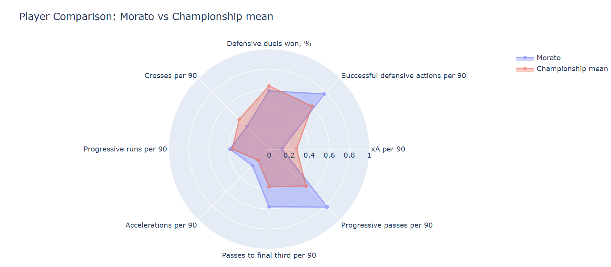

West Ham are already onto their second manager of the season, despite only being 6 points off the league in the Championship. Fan are not happy and several players are getting the brunt of the blame. 

Let's leave the keeper for now but on-loan left back Morato has received a fair amount of criticism. He was brought in by Nuno from his old club Nottingham Forest, with some let's day mixed feedback from Forest fans but was still expected to perform well in the econd tier. 

Let's use the data to assess just how well Morato has performed and see if West Ham need to spend to get an upgrade or if the answer might already be at the London Stadium. 

## How is Morato performing?

Morato seemed to have secured the left back starting position from Olly Scarles who started the season in that spot but made a couple of costly errors. Morato has played 617 minutes compared to Scarles' 507 and was started both of the home defeats against Southampton and West Brom.  

The above radar of Morato's performance this season shows how he comppares to the average of Championship left backs this season. We can see that he's done OK in certain areas. It also gives us an idea of the job Nuno wanted him to do. Be solid defensively and link play on the left and into midfield. For that role we can say he's probably done an OK job.

Morato has struggled , however, to provide much threat as an attacking force. His total 0.36 of expected assits so far is only 0.02 more than Scarles and his 1.6 crosses per 90 minutes puts him way down the list of Championship full backs. Scarles, who has been criticised for his attacking play, attempts exactly double the number of crosses.

With Manor Soloman struggling to make an impact and Austbo still adjusting to life in England only 30% of West Ham' attack have come down the left comapred to 36% through the middle and 34% down the right. They could do with some help on that side. 

- **Projects and dashboards** built with Python and Power BI, each starting from a real football question.
- **Short write-ups** explaining what I found in plain language, not just the code.
- **Honest notes** on what worked, what didn't, and what I'd do differently.

## Do West Ham already have a better left back?

As we have already seen from a quick look at the data it may be that West Ham already have an upgrade in the squad in the shape of Ollie Scarles. He seemed to suffer from a lack of confidence after his mistakes early in the season but a new start under a new manager could be exactly what he needs. 

If you work in or around football analytics, I'd love to hear from you. Get in touch via the [contact page](../../../contact.qmd).
